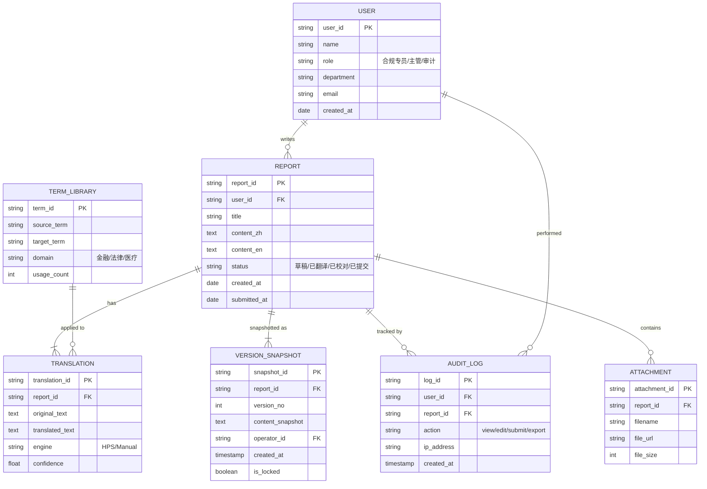
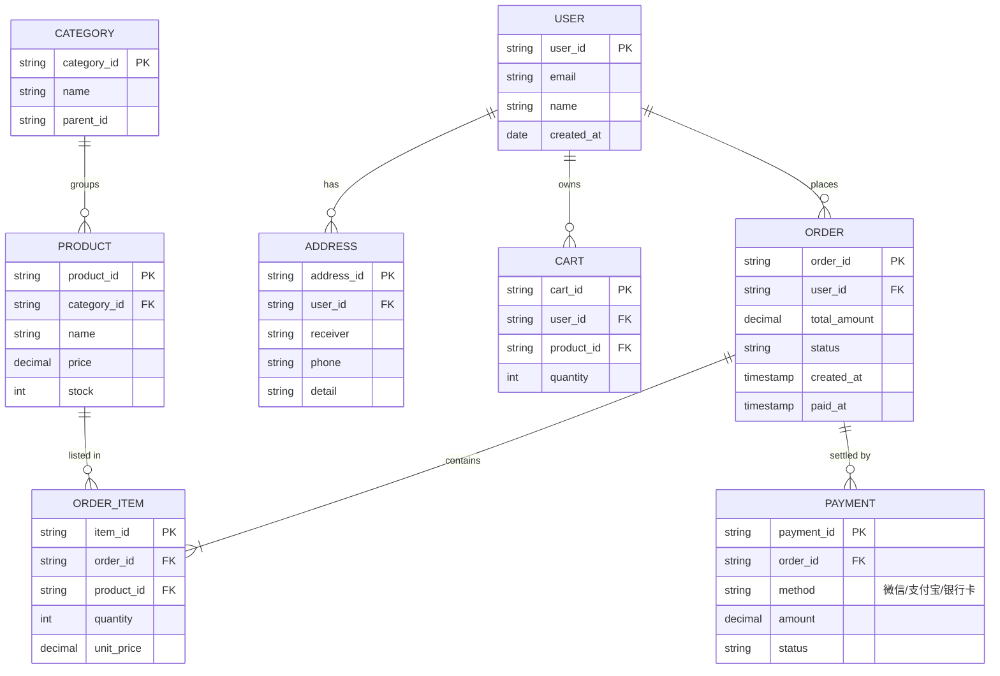
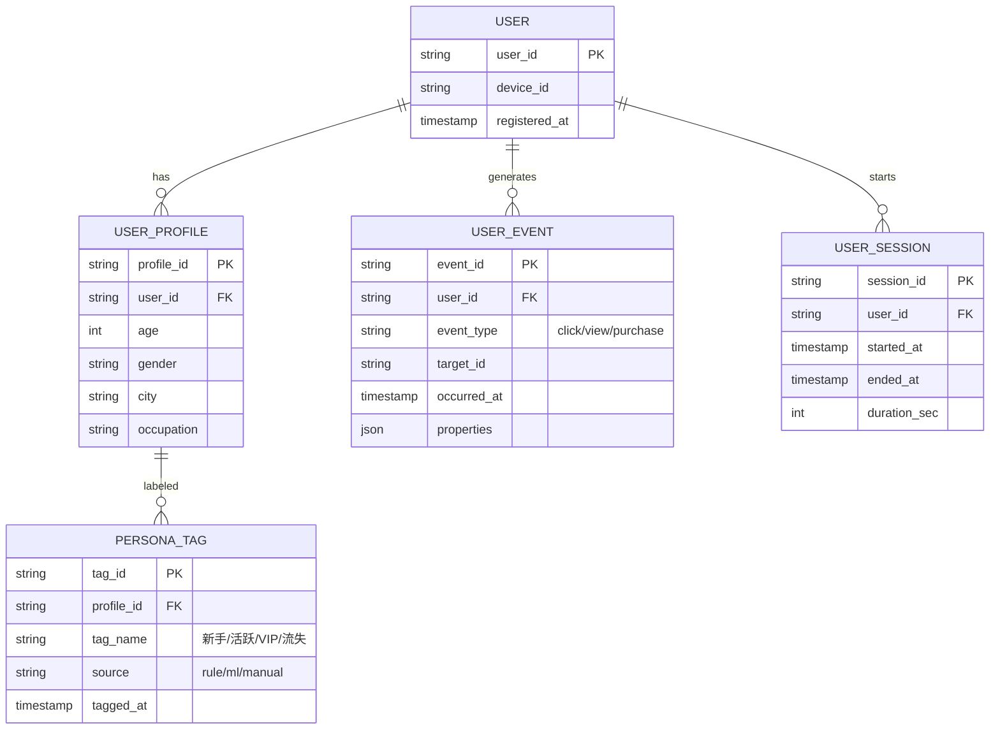

# ER 图模板（Entity Relationship）

> 表达数据模型（B 端必备）

---

## 模板 1：基础 ER 图（语法提示）

> ⚠️ Mermaid 的 erDiagram 是简化版，复杂模型建议用 dbdiagram.io 或 PowerDesigner

---

## 模板 2：RAS 双语录入系统 ER 图

---

## 模板 3：电商订单 ER 图

---

## 模板 4：用户画像 + 行为数据

---

## 实体关系符号

| 符号 | 含义 | 示例 |
|------|------|------|
| `\|\|--\|\|` | 一对一 | 用户 - 身份证 |
| `\|\|--o{` | 一对多 | 用户 - 订单 |
| `}o--o{` | 多对多 | 学生 - 课程 |
| `\|\|--o\|` | 一对零或一 | 订单 - 发票 |

---

## 自建问题

- [ ] 实体是否清晰（不重复定义）？
- [ ] 主外键是否正确？
- [ ] 关系基数是否准确（一/多/零或一）？
- [ ] 关键字段是否标注类型和说明？
- [ ] 是否考虑了软删除（is_deleted）？

---

## 实战技巧

### 命名规范
- 表名用单数（"User" 而非 "Users"）
- 字段名小写下划线（user_id）
- 主键统一以 `_id` 结尾
- 外键 = 关联表 + `_id`

### 字段类型标注
- PK：主键
- FK：外键
- 业务字段：标注数据类型 + 含义
- 枚举值：用注释列出（如 status）

### Mermaid erDiagram 的局限
- 不支持索引
- 不支持视图、存储过程
- 复杂模型建议用工具：dbdiagram.io、MySQL Workbench、Navicat

### B 端补充
- 加 `is_deleted`（软删除）
- 加 `created_at` / `updated_at` / `created_by` / `updated_by`
- 加 `version`（乐观锁）
- 加审计相关字段
