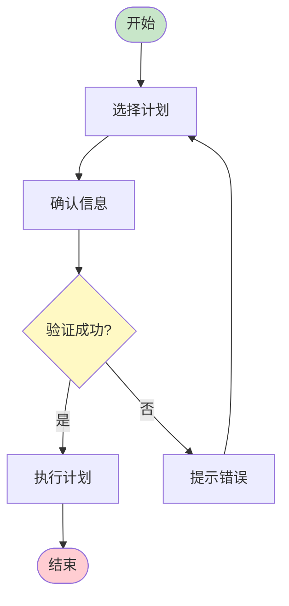
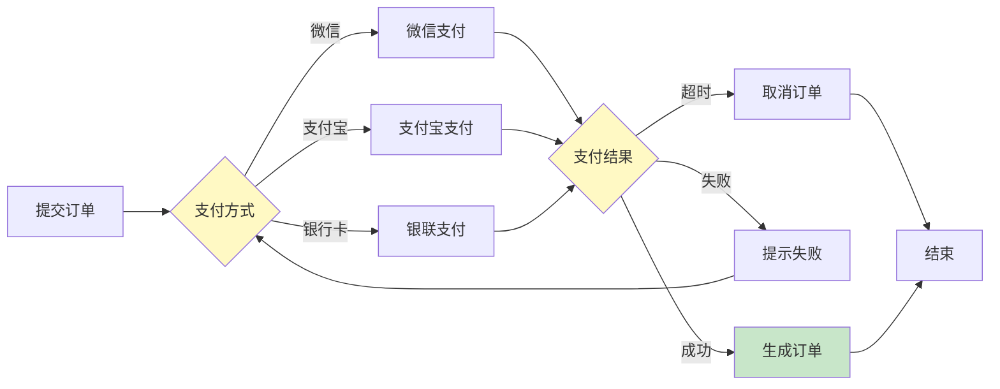
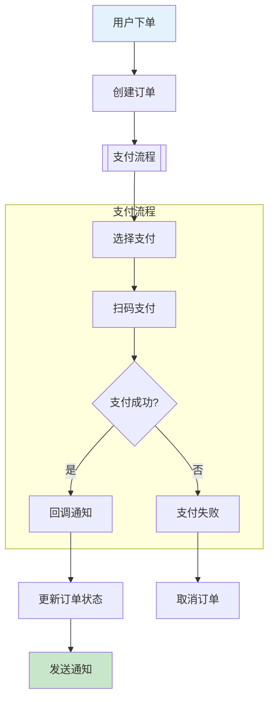
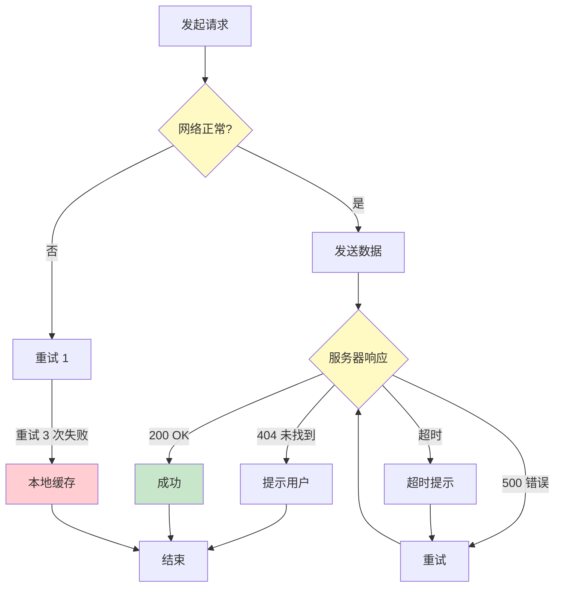
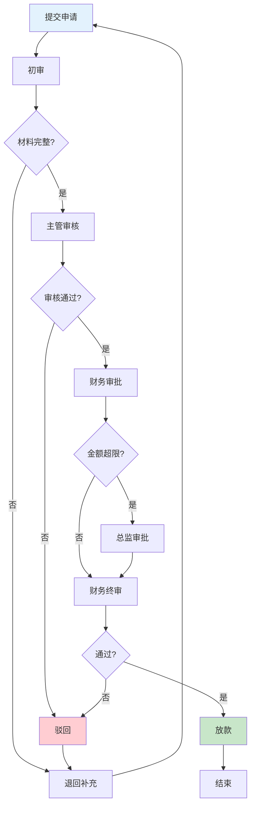
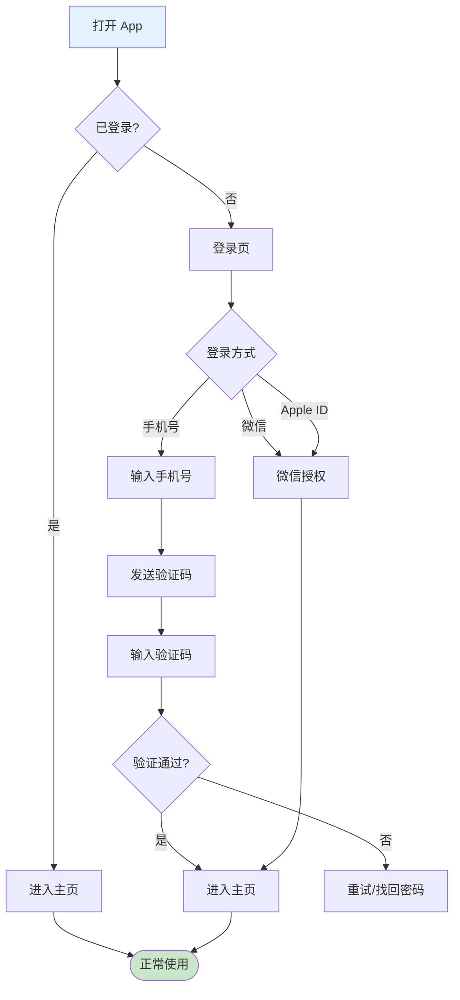

# 流程图模板（Flowchart）

> 业务流程、操作流程的通用表达

---

## 模板 1：基础决策流

---

## 模板 2：多分支流程

---

## 模板 3：含子流程

---

## 模板 4：异常处理流程

---

## 模板 5：B 端审批流程

---

## 模板 6：登录注册流程

---

## 自检问题
- [ ] 起点和终点是否明确？
- [ ] 判断节点是否清晰（菱形 + 条件）？
- [ ] 异常路径是否覆盖？
- [ ] 子流程是否合理封装？
- [ ] 是否太复杂（超过 20 个节点考虑拆分）？

---

## 实战技巧

### 颜色规范
- 起点/终点：绿色（`#c8e6c9`）
- 判断节点：黄色（`#fff9c4`）
- 成功路径：绿色
- 失败/异常路径：红色（`#ffcdd2`）
- 异常流程：橙色

### 文字规范
- 节点标题 ≤8 字
- 判断条件 ≤15 字
- 路径标签清晰（如"是/否"、"成功/失败"）

### 复杂度控制
- 单图不超过 15 个节点
- 超过则用子图（subgraph）或拆分成多张图
