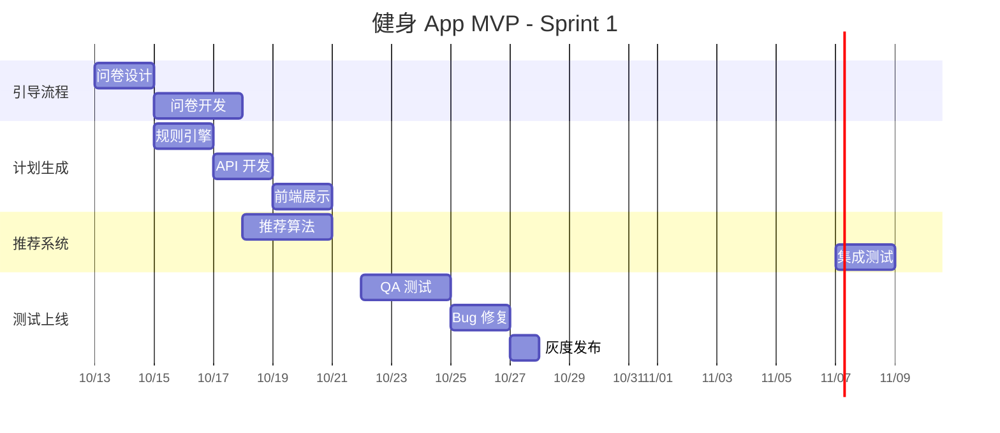
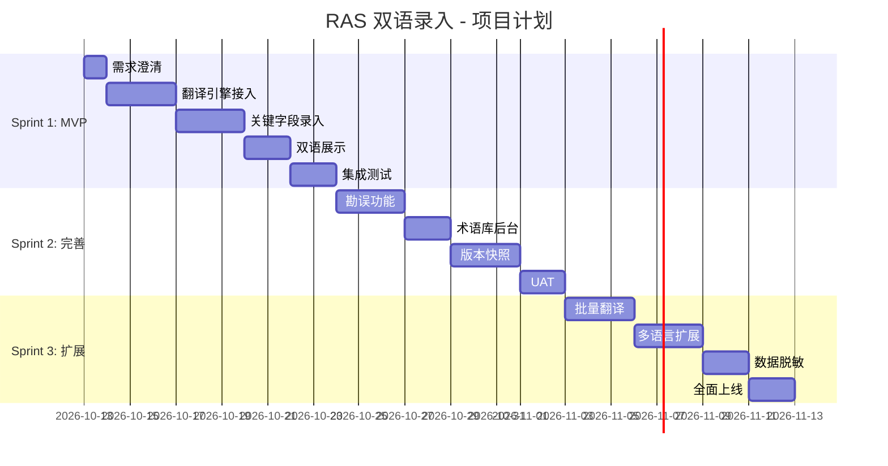
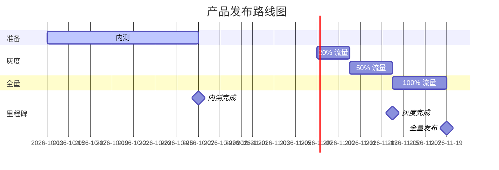
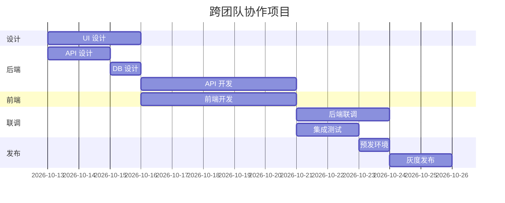

# 甘特图模板（Gantt Chart）

> 项目计划、Sprint 排期

---

## 模板 1：单 Sprint 计划



---

## 模板 2：多 Sprint 路线图



---

## 模板 3：含里程碑



---

## 模板 4：含依赖关系



---

## 甘特图语法

### 任务定义
```
任务名 : 任务ID, 开始日期, 持续天数
任务名 : 任务ID, after 任务ID, 持续天数
```

### 任务状态
- 关键任务：`crit, 任务ID, ...`
- 当前进行：`active, 任务ID, ...`
- 已完成：`done, 任务ID, ...`

### 里程碑
```
里程碑名 :milestone, m1, 2026-10-27, 0d
```

### 分组
```
section 章节名
  任务 : 任务ID, ...
```

---

## 自检问题
- [ ] 任务粒度是否合适（1-5 天）？
- [ ] 任务依赖是否清晰？
- [ ] 关键路径是否标注？
- [ ] 里程碑是否齐全？
- [ ] 是否有 buffer 时间（应对延期）？
