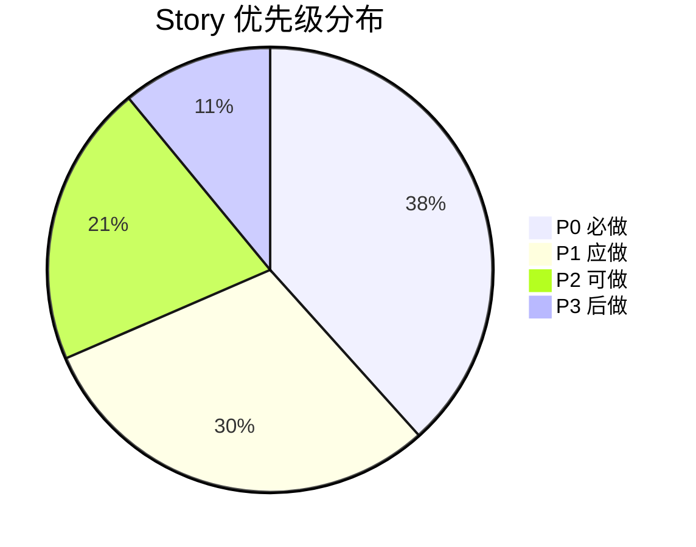
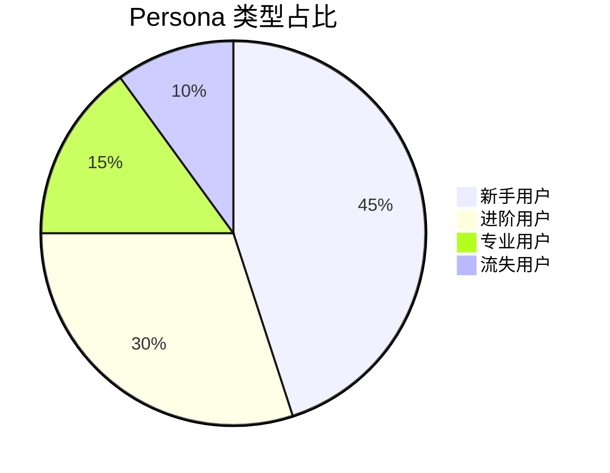
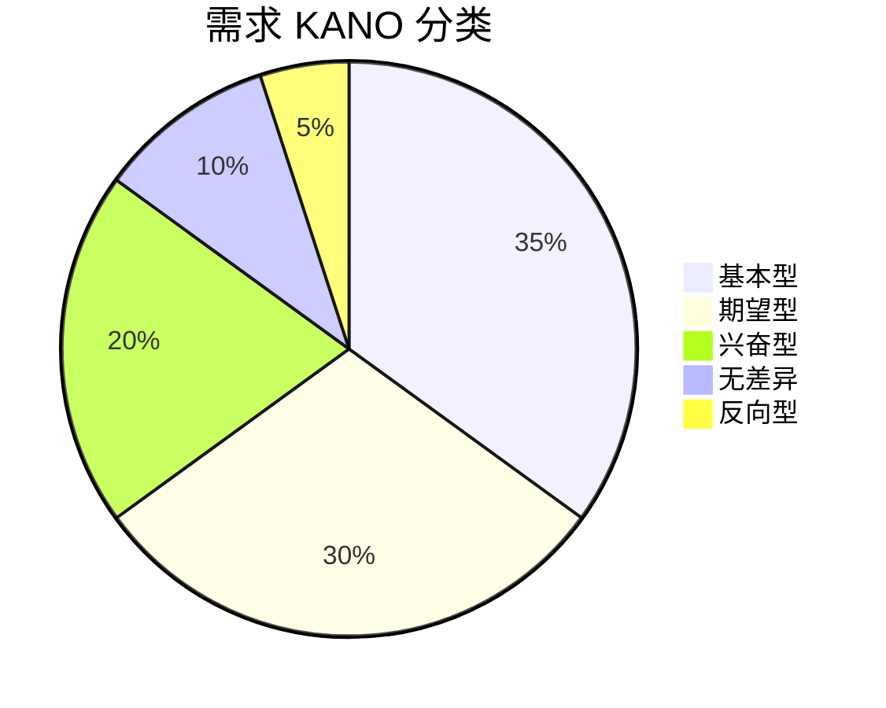
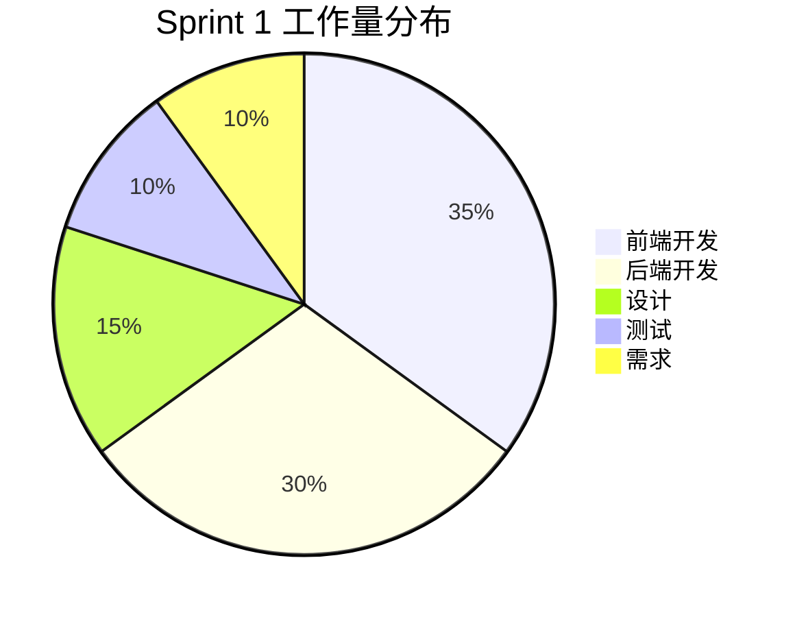

# KANO 雷达图模板（Radar Chart）

> 多维度评分与对比

---

## 模板 1：单产品多维度评分

---

## 模板 2：竞品对比

---

## 模板 3：用户分群对比

---

## 模板 4：C/B 端需求维度对比

---

## 模板 5：版本对比（前后）

---

## 模板 6：Story 优先级矩阵（饼图版）

> 用 pie chart 展示优先级分布

---

## 模板 7：用户类型分布（饼图版）

---

## 模板 8：KANO 分类分布

---

## 模板 9：技术栈占比

---

## 雷达图语法

---

## 实战技巧

### 维度数量
- 雷达图：4-8 个维度最佳
- 饼图：3-7 个分类最佳

### 数据规范
- 数值范围统一（如 0-5 分）
- 数据系列 ≤4 个（太多会重叠）

### 适用场景
- **雷达图**：多维度能力对比、需求差异分析
- **饼图**：占比展示、构成分析
