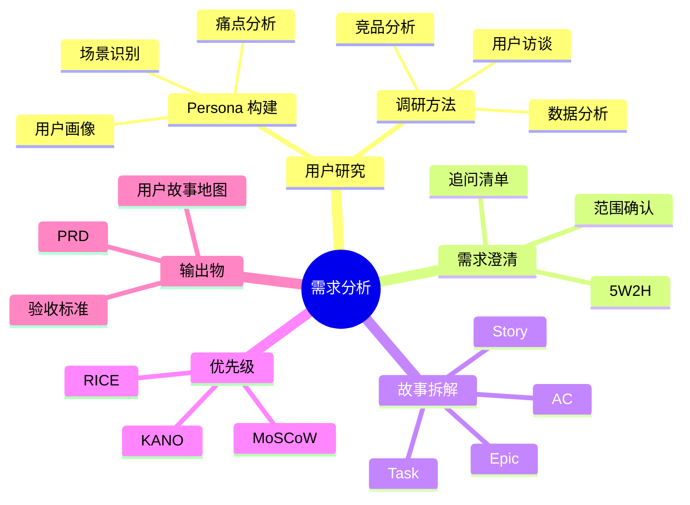
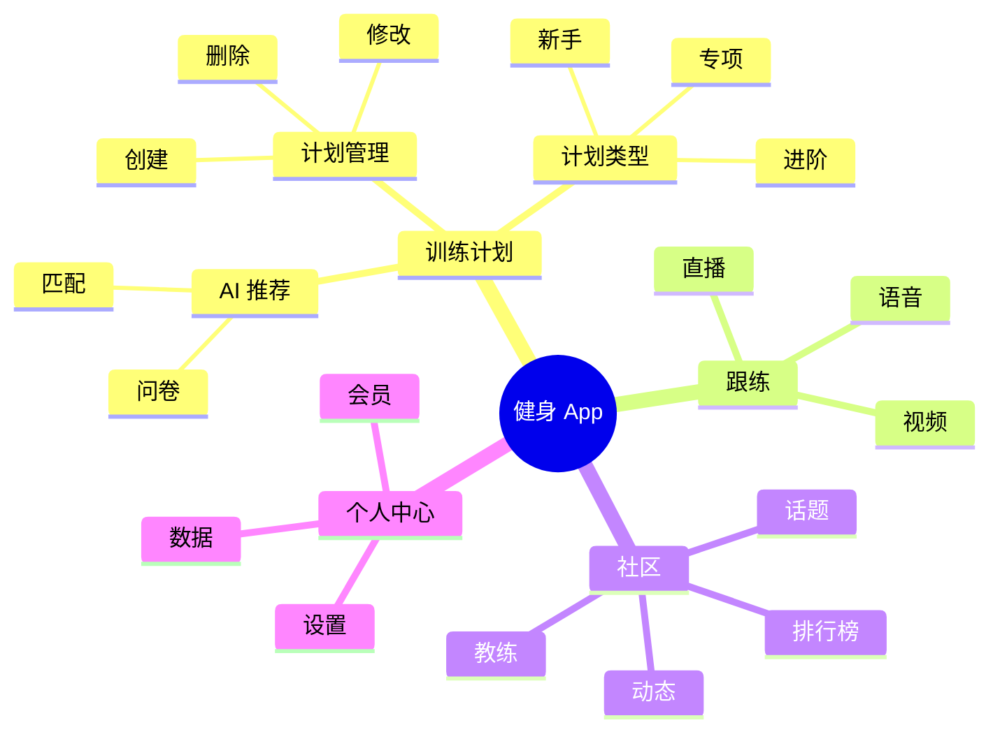
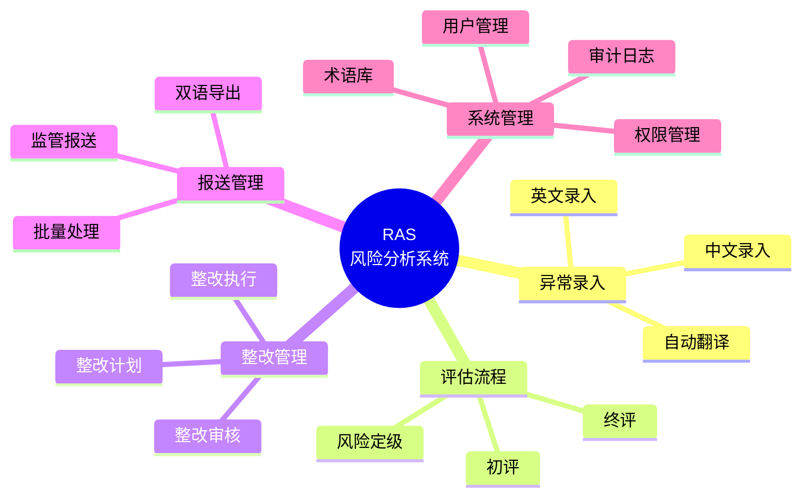
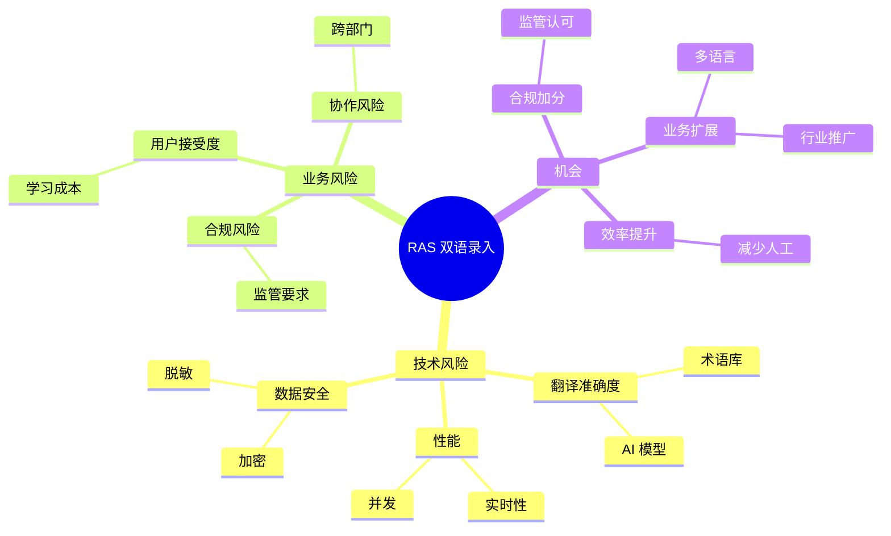
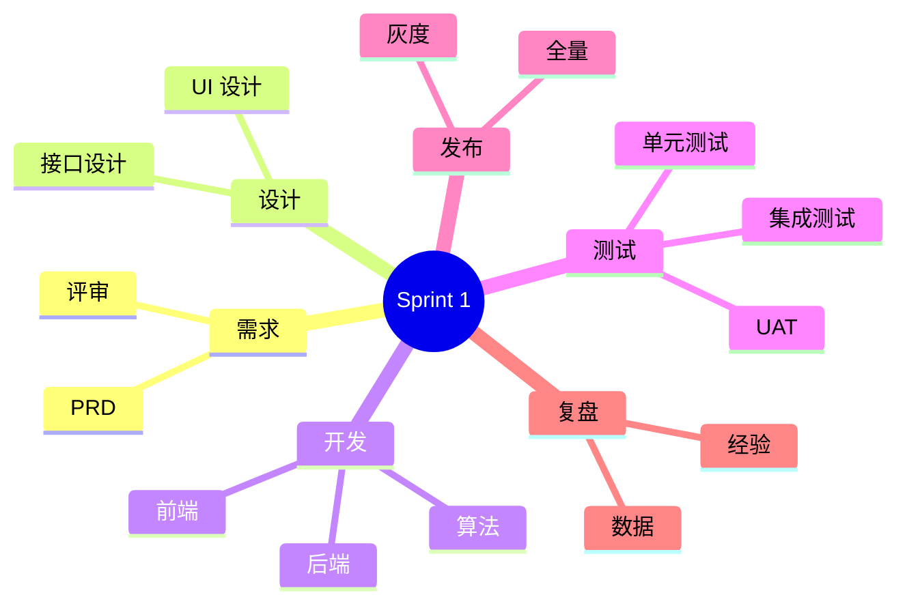
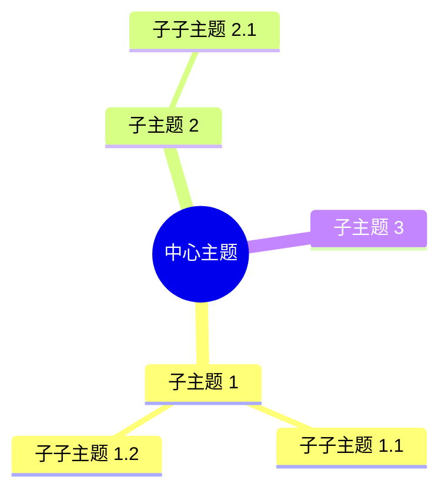

# 思维导图模板（Mind Map）

> 需求结构梳理、头脑风暴

---

## 模板 1：需求拆解



---

## 模板 2：产品功能结构



---

## 模板 3：B 端系统功能结构



---

## 模板 4：风险与机会



---

## 模板 5：Sprint 拆解



---

## 思维导图语法



### 节点形状
```
root((默认))
root(圆角)
root[方形]
root[[子流程]]
```

### 层级
- 通过缩进表示
- 建议不超过 4 层（多了会乱）

---

## 实战技巧

### 使用场景
- 需求头脑风暴
- 功能结构梳理
- 风险与机会分析
- 学习笔记整理
- 项目拆解

### 视觉规范
- 同层节点用相同形状
- 关键节点加粗
- 颜色区分大模块（实际渲染时颜色可能不一致）

### 与其他图配合
- 思维导图梳理结构
- 流程图画具体路径
- 状态机画细节状态
