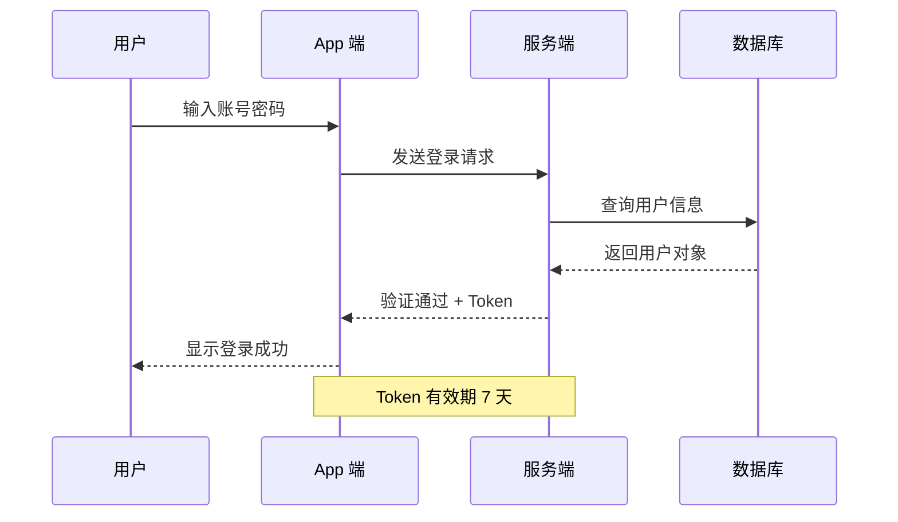
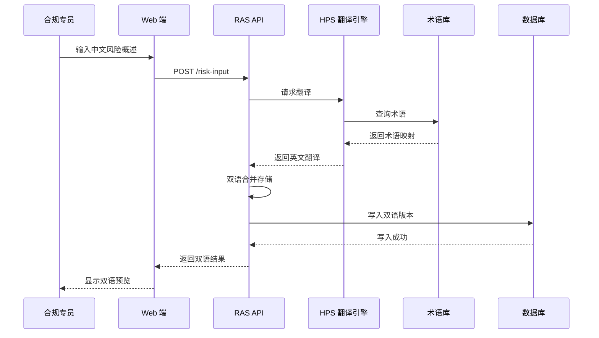
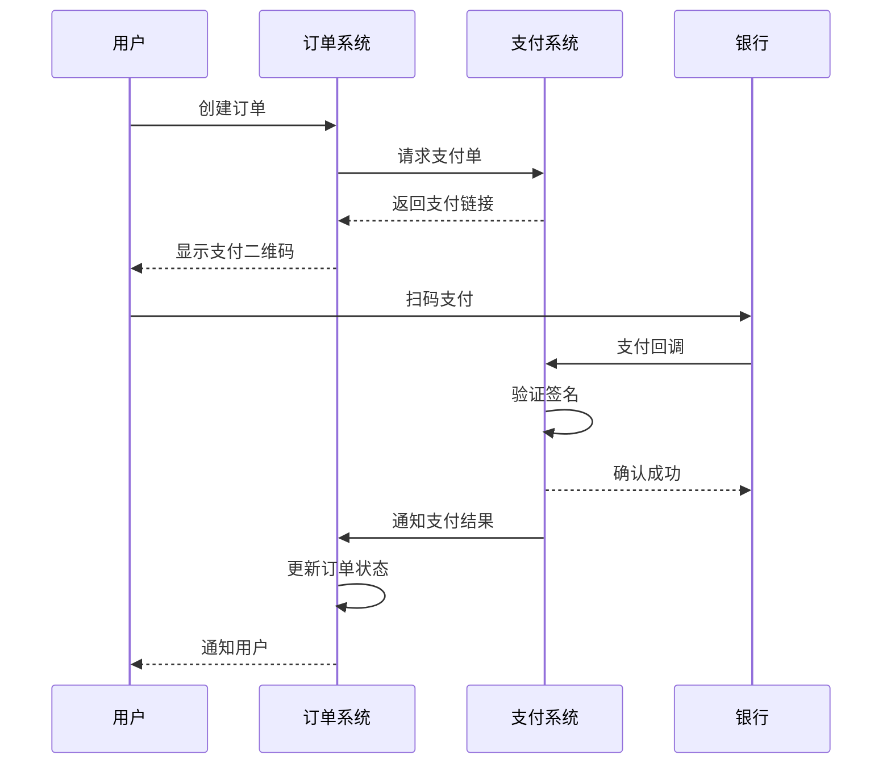
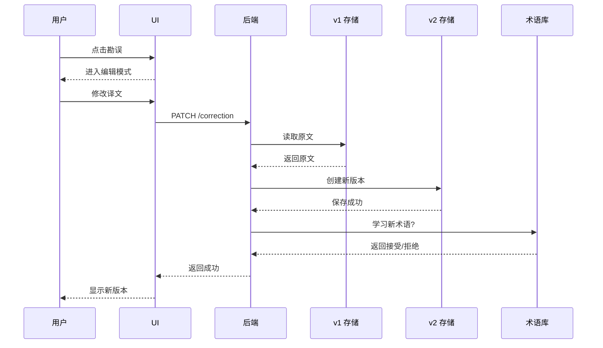
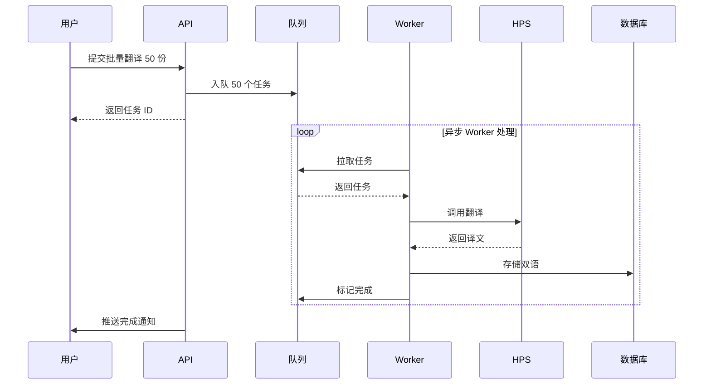
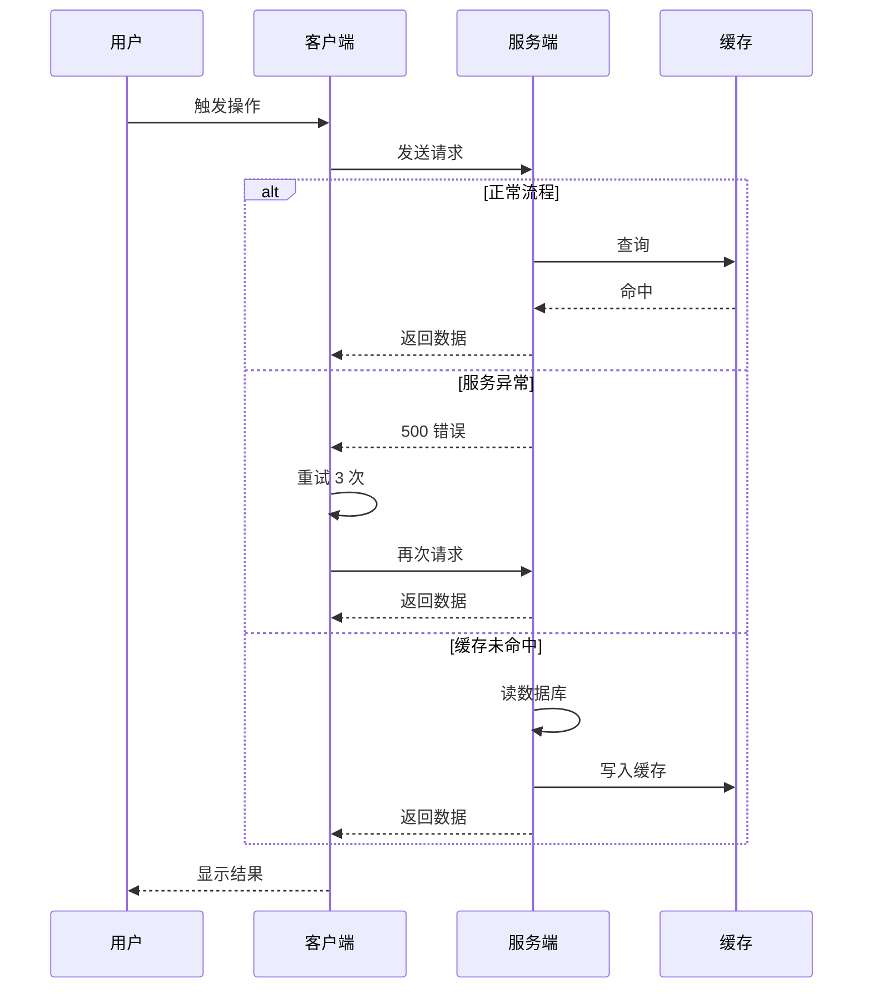

# 时序图模板（Sequence Diagram）

> 表达系统间调用顺序与交互

---

## 模板 1：基础用户登录

---

## 模板 2：RAS 双语录入

---

## 模板 3：支付流程

---

## 模板 4：勘误流程

---

## 模板 5：异步批量任务

---

## 模板 6：含错误处理

---

## 自检问题
- [ ] 所有角色是否都列出来了？
- [ ] 消息方向是否清晰（请求 vs 响应）？
- [ ] 异步 / 同步是否区分？
- [ ] 错误处理路径是否包含？
- [ ] 是否过于复杂（参与者 > 6 个考虑拆）？

---

## 实战技巧

### 方向箭头
- `->>` 实线箭头（同步请求）
- `-->>` 虚线箭头（异步响应）
- `-x` 失败带叉（错误）
- `-)` 开放箭头（异步消息）

### 标注
- `Note over A,B`: A 和 B 之间的注释
- `Note right of A`: A 右侧的注释
- `loop ... end`: 循环
- `alt ... else ... end`: 条件分支
- `par ... and ... end`: 并行

### 命名规范
- 参与者名简洁（人用首字母、系统用简称）
- 消息动词清晰（"查询"、"返回"、"通知"）
- 顺序编号（如 "1. 验证 → 2. 存储"）
