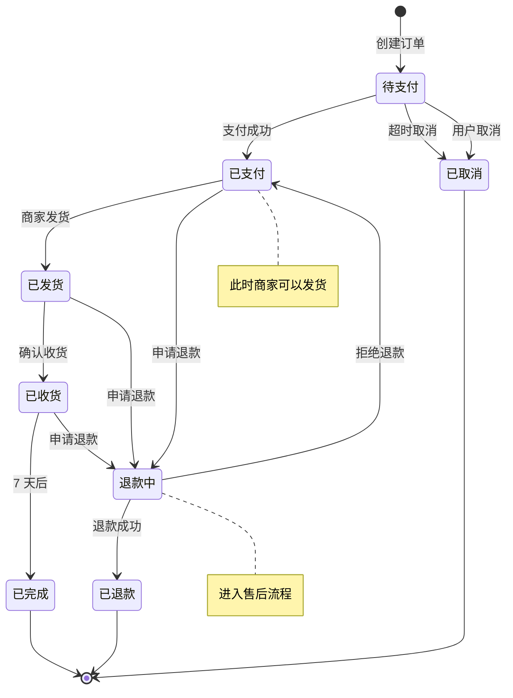
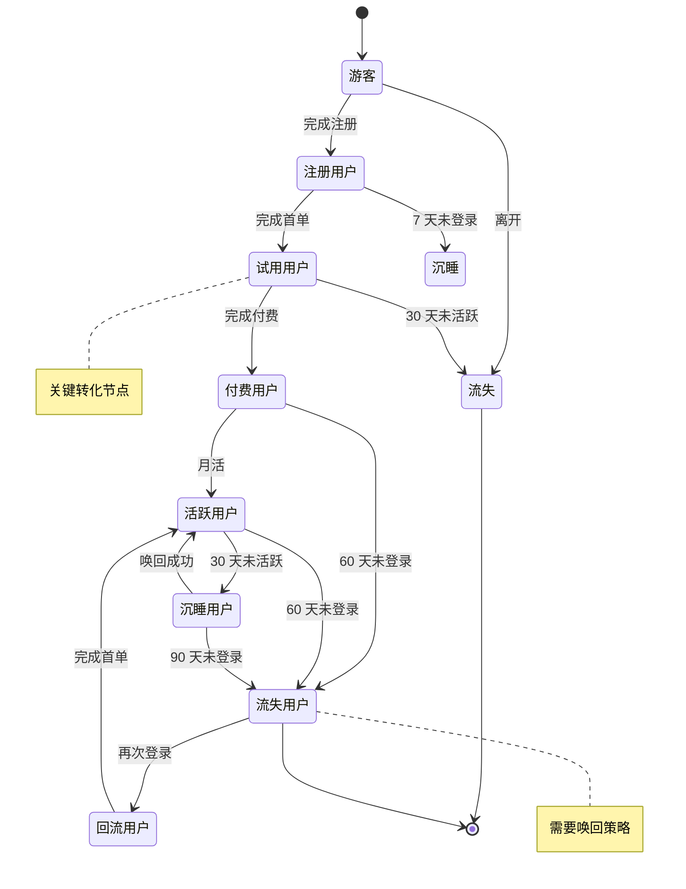
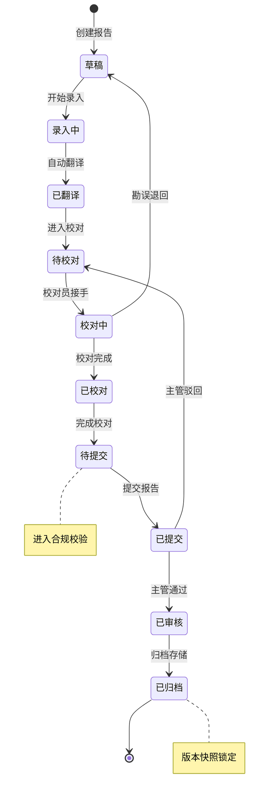
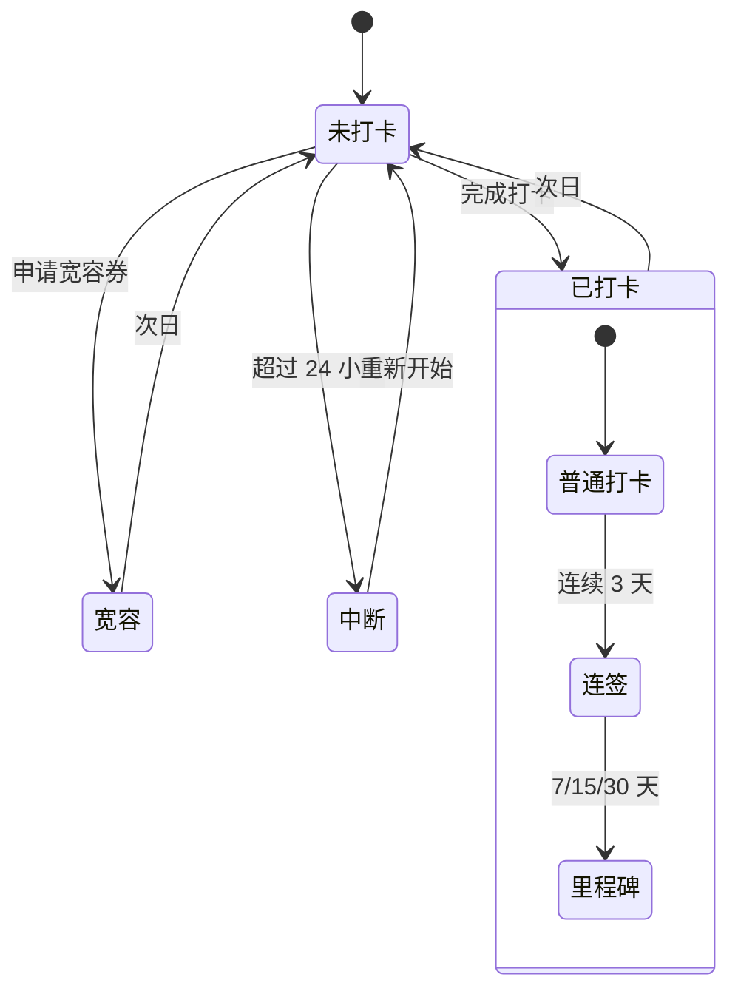

# 状态机模板（State Diagram）

> 表达实体状态流转（订单、用户、合规事件）

---

## 模板 1：订单状态机



---

## 模板 2：用户生命周期



---

## 模板 3：合规事件状态机（B 端）

```mermaid
stateDiagram-v2
    [*] --> 待评估: 触发异常
    待评估 --> 评估中: 分配专员
    评估中 --> 已定级: 完成评估
    评估中 --> 待补充: 材料不足
    
    待补充 --> 评估中: 补充完成
    
    已定级 --> 整改中: 需要整改
    已定级 --> 已关闭: 无需整改
    
    整改中 --> 待审核: 提交整改
    待审核 --> 整改中: 审核驳回
    
    待审核 --> 已整改: 审核通过
    已整改 --> 已关闭: 归档
    
    已关闭 --> [*]
    
    note right of 待评估: 时效要求: 24h
    note right of 整改中: 时效要求: 7 天
    note right of 已关闭: 长期归档
```

---

## 模板 4：异常分析报告状态（B 端）



---

## 模板 5：打卡状态机（C 端）



---

## 自检问题
- [ ] 状态是否穷尽（覆盖所有可能）？
- [ ] 状态间转换是否合理（无非法跳转）？
- [ ] 是否定义了起点和终点？
- [ ] 关键状态是否有注释？
- [ ] 时效要求是否标注？

---

## 实战技巧

### 命名规范
- 状态名简洁明确（"待支付"优于"等待用户完成支付"）
- 动作名清晰（"支付成功"而非"成功"）
- 状态机粒度一致（不要混"未支付"和"等待支付完成"）

### 颜色与强调
- 关键节点用颜色突出
- 终止状态加粗
- 时效/合规要求用 note 标注

### 组合状态
- 用 `state 父状态 { ... }` 表示嵌套状态
- 适合复杂的子状态（如订单的"售后"包含多个子状态）
