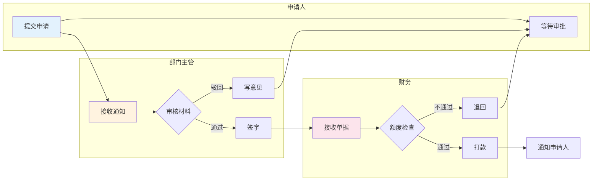
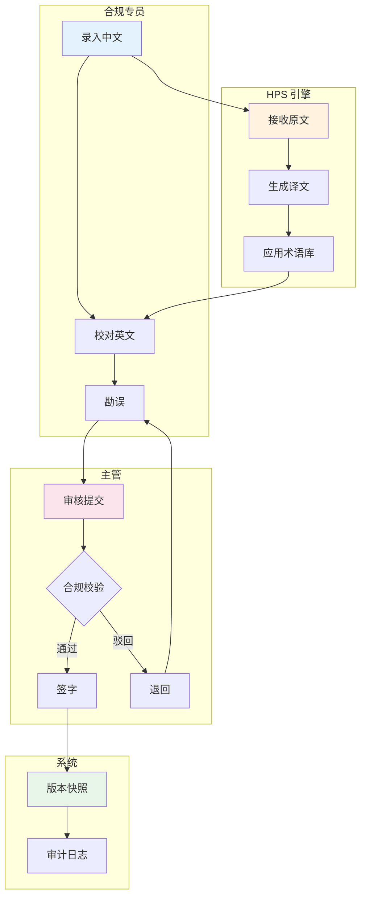
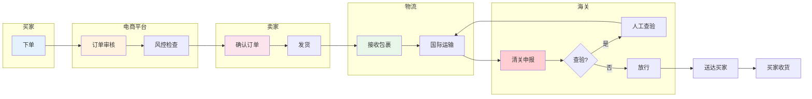
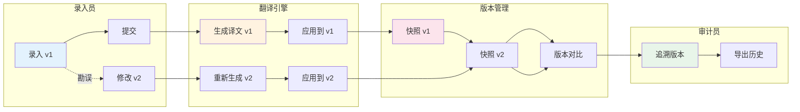

# 泳道图模板（Swimlane Diagram）

> 表达多角色/多系统的协作流程（B 端场景必备）

---

## 模板 1：B 端审批流（3 角色）

---

## 模板 2：合规录入流程（4 角色）

---

## 模板 3：跨境订单处理

---

## 模板 4：版本管理流程

---

## 自检问题
- [ ] 每个角色是否清晰定义？
- [ ] 角色间交接是否明确？
- [ ] 异常路径是否覆盖（驳回、退回）？
- [ ] 每个角色内部流程是否完整？
- [ ] 是否需要进一步拆分系统 vs 业务角色？

---

## 实战技巧

### 角色设计
- 按组织角色分：申请人、主管、财务、法务、IT
- 按系统角色分：前端、后端、数据库、第三方服务
- 混合模式：业务角色 + 系统角色（适合复杂流程）

### 颜色规范
- 每个角色一个主色调
- 蓝色系：用户/客户
- 黄色系：审核/中台
- 粉色系：决策/管理层
- 绿色系：后台/系统

### 文字精简
- 节点文字 ≤10 字
- 状态/分支用关键词（"通过"、"驳回"、"已读"）

### 流程方向
- 横向（LR）：角色少、流程短
- 纵向（TB）：角色多、流程长
