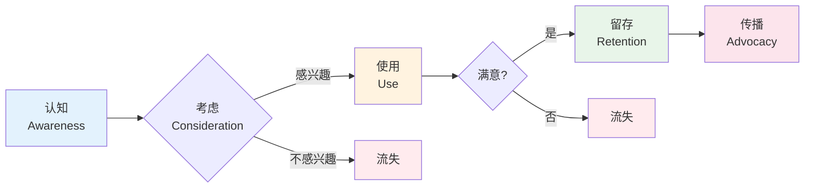
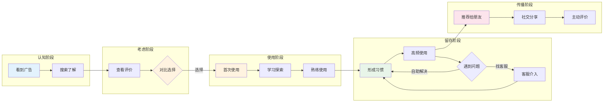
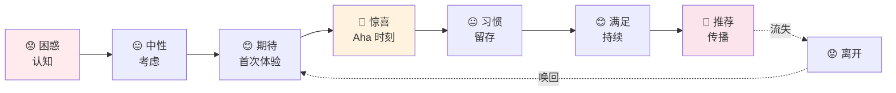
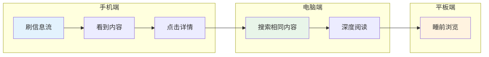
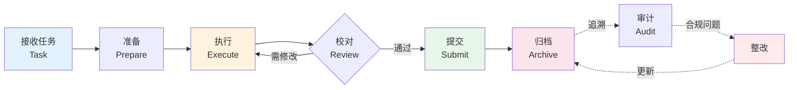
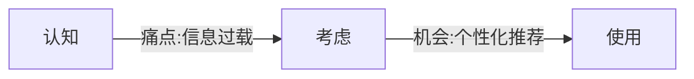

# 用户旅程图模板（User Journey Map）

> 展示用户从认知到传播的完整体验路径。

---

## 模板 1：基础版（5 阶段）



---

## 模板 2：详细版（含触点）



---

## 模板 3：情绪曲线版



---

## 模板 4：跨设备旅程



---

## 模板 5：B 端版本（6 阶段）



---

## 自检问题
- [ ] 是否覆盖了完整旅程（认知 → 传播 / 流失）？
- [ ] 触点是否具体（不是"用户想做什么"）？
- [ ] 关键节点是否有标注（情绪、Aha 时刻）？
- [ ] 流失路径是否清晰？
- [ ] 唤回路径是否包含？

---

## 实战技巧

### 添加痛点和机会点
可以用注释文字：


### 用颜色表达情绪
- 红色系：负面情绪（😟😕）
- 黄色系：中性（😐）
- 绿色系：正面（😊🤩）

### 突出 Aha 时刻
用特殊节点符号（emoji + 颜色）：
```mermaid
D[🤩 Aha!<br/>首次成功]
style D fill:#ffeb3b,stroke:#f57f17,stroke-width:3px
```
