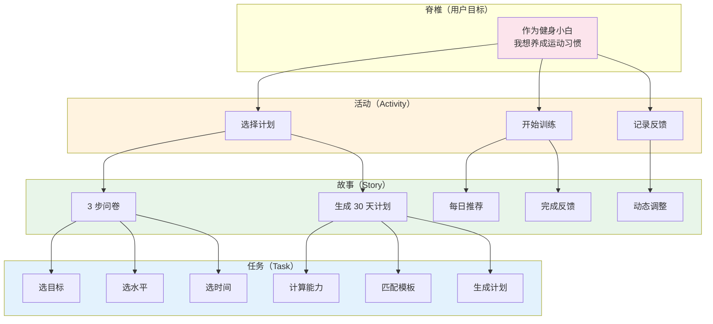
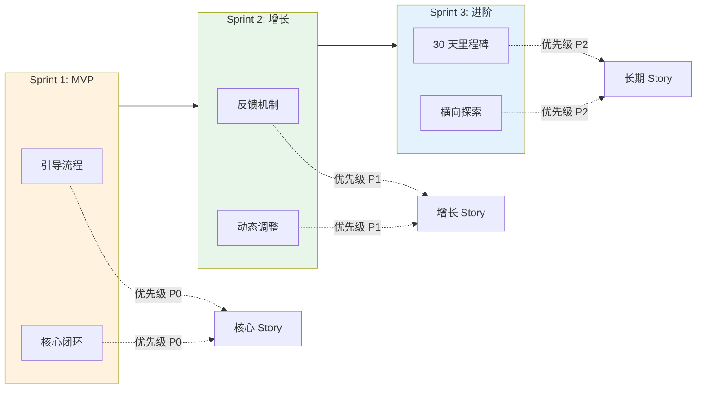
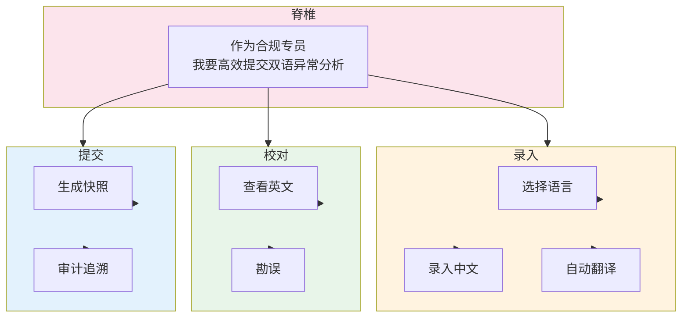
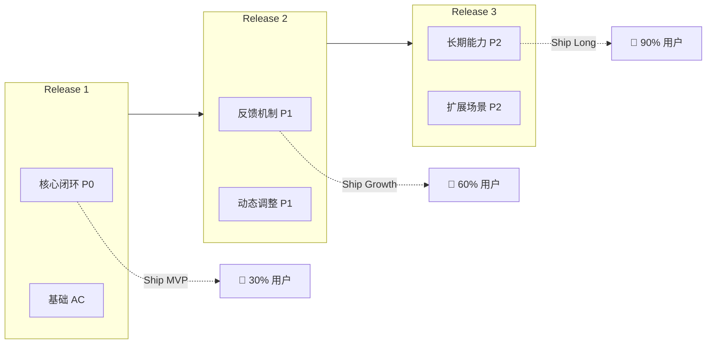

# 用户故事地图模板（User Story Map）

> 按 Jeff Patton 方法拆解：Spine → Activity → Story → Task

---

## 模板 1：标准故事地图

---

## 模板 2：时间分层版

---

## 模板 3：B 端流程版本

---

## 模板 4：切割 Release 版

---

## 自检问题
- [ ] Spine 是否清晰表达了用户目标？
- [ ] Activity 是否是"活动"而非"功能"？
- [ ] Story 是否独立、可估算？
- [ ] 切割线是否明确（每个 Release 的边界）？
- [ ] 优先级是否与切割一致？

---

## 实战技巧

### 切割规则
- 每个 Release 必须能独立发布
- 每个 Release 包含 1-2 个 P0 Story
- 增量价值：每个 Release 比前一个增加 1-2 个能力

### 横向切割 vs 纵向切割
- 纵向：按时间分 Release（推荐）
- 横向：按用户角色分（如：合规专员 / 监管员各自先做核心）
- 斜向：按场景分（如：紧急场景 vs 常规场景）

### 避免
- ❌ Spine 太宽泛（"用户用得开心"）
- ❌ Activity 是功能名（"我要设置功能"）
- ❌ Story 粒度太大（"我要完整系统"）
