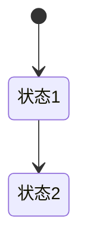

# Figma 集成桥接指南（Bridge Guide）

> 如何把 Skill 的输出自动转换为 Figma 原型。

---

## 架构

```
┌─────────────────┐
│ Skill 输出       │
│ (Markdown)      │
│ + Mermaid 图     │
└────────┬────────┘
         │
         ↓ 复制粘贴
┌─────────────────┐
│ Figma 插件 UI    │
│ (粘贴文本)       │
└────────┬────────┘
         │
         ↓ 解析 + 生成
┌─────────────────┐
│ Figma 原型       │
│ - Frame         │
│ - 文本节点       │
│ - Mermaid 占位   │
└─────────────────┘
```

---

## 两种使用方式

### 方式 1：Figma 插件（推荐）

完整流程：
1. 在 Codex 中运行 Skill，得到 Markdown
3. 打开 Figma → 插件 → 运行 "User Story Analyst"
4. 粘贴 Markdown
5. 点击"生成 Figma 原型"

### 方式 2：手动复制 Mermaid 图

如果不想用插件：
1. 复制 Skill 输出中的 ` ```mermaid ` 代码块
2. 打开 https://mermaid.live/
4. 粘贴代码 → 渲染 SVG
5. 在 Figma 中粘贴（Cmd+V / Ctrl+V）

---

## 插件安装（开发者模式）

### 第 1 步：准备文件
```bash
# 复制整个 figma-plugin 目录
cp -r /Users/llh_me/Documents/app/codex/agents/c-user-story-analyst/figma-plugin /Users/your-name/Documents/

# 重命名 code.js 为 code.ts（Figma 插件要求）
cd /Users/your-name/Documents/figma-plugin
mv code.js code.ts
```

### 第 2 步：Figma 中加载
1. 打开 Figma 桌面端
2. 菜单 → Plugins → Development → New Plugin
3. 选择 `figma-plugin` 目录下的 `manifest.json`
4. 点击 "Run" 运行插件

### 第 3 步：使用
1. 选中 Plugin → User Story Analyst
2. 粘贴 Skill 输出
3. 点击"生成 Figma 原型"

---

## 插件支持识别的格式

| 输入 | 识别规则 | 生成 Figma 节点 |
|------|---------|---------------|
| 标题 | `# 标题` | 主标题文本 |
| 场景判断 | `**场景类型**：C 端` | 场景徽章 |
| 用户画像 | `### Persona 1: 昵称` | 灰色卡片 |
| 用户故事 | `作为 [X]，我想要 [Y]，以便 [Z]` | 黄色 Story 卡 |
| Mermaid 图 | ` ```mermaid ... ``` ` | 蓝色占位框（含原始代码） |
| 验收标准 | `Given... When... Then` | 文本列表 |

---

## Skill 输出模板（推荐格式）

为了让插件识别效果最好，请按以下格式输出：

```markdown
# [需求名称]

**场景类型**：C 端 / B 端轻量

## 用户画像

### Persona 1: [昵称]
（描述...）

### Persona 2: [昵称]
（描述...）

## 用户故事

作为 [角色]，我想要 [能力]，以便 [价值]。

作为 [角色]，我想要 [能力]，以便 [价值]。

## 可视化图表




## 验收标准

✅ Given [前置]
   When [操作]
   Then [结果]
```

---

## 进阶：扩展插件

### 添加新的节点类型

编辑 `code.ts`，在 `handleSkillOutput()` 中添加：

```javascript
// 新增：优先级图表
if (parsed.priorities) {
  const prioritySection = createSection("🎯 优先级排序", 36);
  mainFrame.appendChild(prioritySection);
  // 添加你的渲染逻辑
}
```

### 自定义颜色规范

修改 `createPersonaCard()` 中的 `card.fills`：
```javascript
card.fills = [{ type: 'SOLID', color: { r: 0.97, g: 0.97, b: 0.97 } }];
// 改为你的品牌色
card.fills = [{ type: 'SOLID', color: { r: 0.95, g: 0.92, b: 0.98 } }];
```

---

## 限制与说明

### 插件能做什么 ✅
- 解析 Markdown 标题、卡片、列表
- 创建 Frame + 自动布局
- 包含用户故事卡片
- 显示 Mermaid 原始代码

### 插件不能做什么 ❌
- 直接渲染 Mermaid 图为 SVG（需用 mermaid.live）
- 识别复杂表格（仅显示首行）
- 自动创建组件库（需手动）

### 升级路径
- **v1.0**（当前）：基础解析 + Frame 生成
- **v2.0**（计划）：集成 mermaid.js 库，自动渲染 Mermaid
- **v3.0**（计划）：双向同步 + 组件库自动生成

---

## 故障排查

### Q1: 插件没有出现在菜单中
检查 `manifest.json` 中的 `editorType` 是否为 `["figma"]`，不是 `["figjam"]`。

### Q2: 点击生成没反应
打开 Figma 的开发者工具（Plugins → Development → Open Console）查看错误。

### Q3: Mermaid 图只显示代码
v1.0 不支持直接渲染，需手动复制代码到 mermaid.live 渲染后粘贴。

### Q4: 用户故事没识别
必须用 `作为 [X]，我想要 [Y]，以便 [Z]` 的格式，X、Y、Z 必须用方括号包裹。

---

## 相关资源

- Mermaid 在线渲染：https://mermaid.live/
- Figma 插件开发文档：https://www.figma.com/plugin-docs/
- Skill 项目路径：`/Users/llh_me/Documents/app/codex/agents/c-user-story-analyst/`
