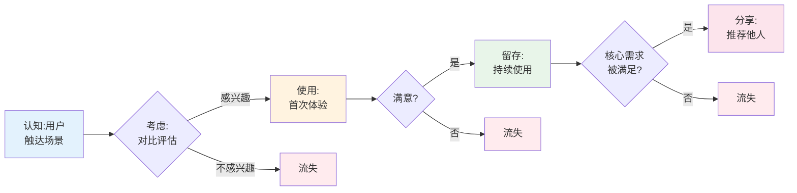

# 用户旅程图模板（Journey Map Template）

## 旅程阶段一：认知
| 维度 | 内容 |
|------|------|
| **触点** | 用户在哪里第一次接触到这个产品/功能 |
| **用户行为** | 用户做了什么 |
| **用户想法** | 用户内心在想什么 |
| **情绪曲线** | 😟😕😊🤩（-2 ~ +2） |
| **痛点** | 哪里不好/卡住/困惑 |
| **机会点** | 我们能做什么优化 |

## 旅程阶段二：考虑
（同上）

## 旅程阶段三：使用 / 首次体验
（同上）

## 旅程阶段四：持续使用
（同上）

## 旅程阶段五：分享传播
（同上）

## 旅程阶段六：流失/唤回（可选）
（同上）

---

## Mermaid 旅程图（图形化表达）



---

## 情绪曲线（ASCII 表示）

```
情绪
 +2 🤩  ──────────────●（使用后满足）
 +1 😊  ──────●────────────●
  0 😐  ●─────────●（考虑期）
 -1 😕  ────●（首次接触困惑）
 -2 😟  ●（认知）
              认知   使用   留存   传播
```

---

## 关键发现模板

### 痛点 Top 3
1. **[痛点 1]**：发生在 [阶段]，影响 [人群比例/频率]，造成 [业务后果]
2. **[痛点 2]**
3. **[痛点 3]**

### 机会点 Top 3
1. **[机会 1]**：[在哪个阶段] + [做什么] + [预期价值]
2. **[机会 2]**
3. **[机会 3]**

---

## 自检问题
- [ ] 是否覆盖了完整旅程（认知 → 流失）？
- [ ] 痛点是否具体可感知（不是"用户体验差"这种笼统说法）？
- [ ] 机会点是否可执行（不是"提升满意度"）？
- [ ] 情绪曲线是否符合真实用户感受？
